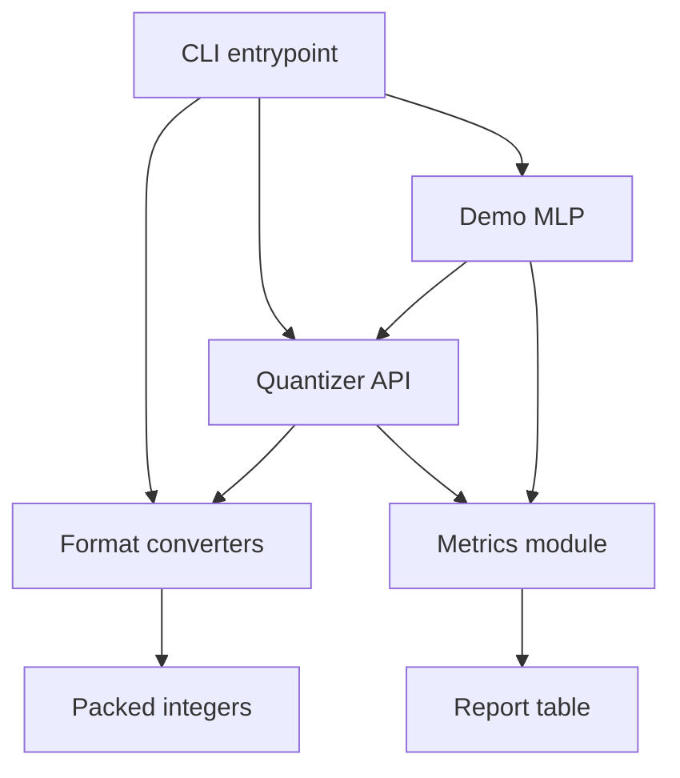
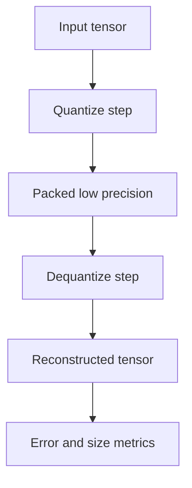

# quant-playground

[](https://github.com/theraihanrakibb/quant-playground/actions/workflows/ci.yml)
[](LICENSE)
[](https://www.python.org/downloads/)

An **educational quantization playground** that makes low-precision number
formats tangible. It emulates **FP8 (E4M3 / E5M2)**, **FP4 (E2M1)**, **INT8**,
and **INT4** entirely in pure Python + numpy, then measures round-trip error,
size reduction, and the impact of each format on a toy model's accuracy.

No torch. No GPU. No model downloads. Fully deterministic and CPU-only.

## Overview

Modern inference stacks squeeze models into low-precision formats to cut memory
footprint and memory-bandwidth. To reason about *which* format to use and *what
it costs in accuracy*, you first need to understand how the formats themselves
behave. `quant-playground` lets you:

* Pack and unpack float values into FP8/FP4 bit fields by hand (sign / exponent
  / mantissa), with round-to-nearest and saturation.
* Apply symmetric integer quantization (INT8 / INT4) with a per-tensor scale.
* Quantify the damage of a round-trip with MSE, MAE, SNR, and cosine similarity.
* See the byte-level win (e.g. `fp32` 4 bytes -> `fp8` 1 byte = **4x** smaller).
* Run a tiny numpy MLP before and after quantization and read off which format
  preserves accuracy best.

## Architecture





## Quickstart

```bash
# install (no venv needed for the demo/tests)
python -m pip install -r requirements.txt

# quantize a random tensor and see the error/size report
python -m quant_playground.cli quantize --bits 8 --format fp --shape 1024

# run the toy MLP comparison across every format
python -m quant_playground.cli demo

# restrict the demo to one format
python -m quant_playground.cli demo --format fp4
```

Run the test suite (CPU only, no network):

```bash
python -m pytest -q
```

## CLI reference

| Command | Options | Description |
| --- | --- | --- |
| `quantize` | `--bits`, `--format`, `--tensor`, `--shape`, `--scale`, `--seed` | Synthesize a tensor, quantize it, and print a round-trip report. |
| `demo` | `--format`, `--seed` | Quantize a toy MLP's weights per format and print an accuracy-impact table. |

`--format` accepts `fp` / `float` or `int` / `integer` (combined with `--bits` 4 or 8),
or an explicit name like `fp8_e4m3`, `fp8_e5m2`, `fp4_e2m1`, `int8`, `int4`.

## API reference

```python
import numpy as np
from quant_playground import formats, quantizers, metrics

# 1. Manual format conversion
bits = formats.fp32_to_fp8_e4m3(np.array([1.23, -4.56]))
values = formats.fp8_e4m3_to_fp32(bits)

# 2. Quantizer API (quantize -> dequantize)
qz = quantizers.get_quantizer("fp", 8)   # FP8 E4M3
x = np.linspace(-3, 3, 1024)
report = metrics.round_trip_report(x, qz)
print(report["compression_ratio"], report["cosine"])

# 3. Integer quantization with an explicit scale
q = formats.fp32_to_int8(np.array([-2.0, 0.0, 2.0]), scale=2.0)  # -> [-1, 0, 1]
```

Format specs implemented:

| Format | Sign | Exponent | Mantissa | Bias | Max normal |
| --- | --- | --- | --- | --- | --- |
| FP8 E4M3 | 1 | 4 | 3 | 7 | 240 |
| FP8 E5M2 | 1 | 5 | 2 | 15 | 57344 |
| FP4 E2M1 | 1 | 2 | 1 | 1 | 6 |
| INT8 | signed | symmetric, scale | | | 127 |
| INT4 | signed | symmetric, scale | | | 7 |

## Why this matters for AI infra

FP8 and FP4 are the workhorses of modern **LLM and diffusion serving**. H100 /
Blackwell-class GPUs expose FP8 (and emerging FP4) tensor cores because going
from FP16 to FP8 halves memory and bandwidth, and FP4 can halve it again —
directly raising throughput and cutting cost per token. But every step down in
precision trades accuracy for efficiency, and the error is *not* uniform across
formats or across the value distribution.

Understanding the bit-level layout (where the exponent lives, how subnormals
and saturation behave, how a symmetric integer scale maps the dynamic range) is
a core **inference-optimization** skill. This playground turns that theory into
something you can poke at: quantize a tensor, watch the round-trip error, and
see a real (if tiny) network's outputs drift under each format. It is a
stepping stone toward block-wise scaling (MXFP4 / NVFP4), mixed-precision
planning, and calibration — the techniques behind production low-precision
serving.

## Future work

* Block-wise / per-channel scaling (microscaling, MXFP4 / NVFP4 style).
* Stochastic rounding option in addition to round-to-nearest.
* Optional matplotlib plots of the error distribution (import is guarded so
  tests never need it).
* Mixed-precision allocator that picks a format per layer from an accuracy
  budget.
* Pre-commit hooks (ruff, mypy) and a coverage report in CI.

## License

MIT — see [LICENSE](LICENSE).
